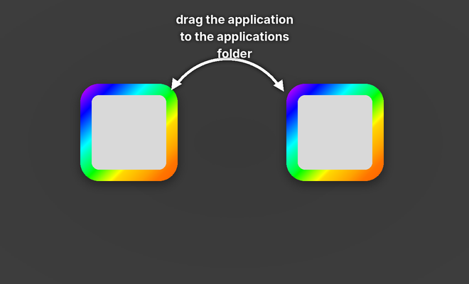

# DMG Creator

A Mac app for building `.dmg` disk images with a custom background and
hand-placed icons — the window people see when they double-click your
installer.

Drop an app in, drop a background image in, drag the icons where you want
them, press **Build DMG**. What the preview shows is what the Finder shows
when the image is mounted.



## What it does

- **Starts ready to go**: every new project opens with the dark two-slot
  background below, 660 × 400, with the `Applications` shortcut already in its
  slot. Drop your app in the left slot and build.
- **Live preview** of the mounted window: real background image, real icon
  sizes, real positions. Drag icons around; the numbers are the ones written
  into the image.
- **Custom background**, with an optional `@2x` version so the artwork stays
  sharp on Retina displays (both are packed into one multi-resolution TIFF).
- **Drag and drop** apps, folders and files straight onto the preview.
- The **`Applications` shortcut** everyone expects, in one click.
- **Window size, position, icon size and label size**, all editable.
- **Custom volume icon** (`.icns`).
- **Compression**: zlib, lzfse, bzip2, lzma, or uncompressed.
- **Code signing** of the finished image with your Developer ID.
- **Projects** save to `.dmgproj` files, so a release build is repeatable.
- Everything the app does is also available as a **command line tool**, and
  the app shows you the exact command it ran.

## Requirements

- macOS 13 (Ventura) or newer
- Xcode command line tools — `xcode-select --install` if you have not got them

## Build and install

```bash
git clone https://github.com/inew745/dmgcreate.git
cd dmgcreate
./build.sh --install --run
```

That compiles the app, assembles `DMG Creator.app`, copies it into
`/Applications` and launches it.

Other options:

```bash
./build.sh              # just build, into ./build/DMG Creator.app
./build.sh --dmg        # also wrap the app in its own disk image
./build.sh --universal  # one binary for Apple silicon and Intel
./build.sh --sign "Developer ID Application: Your Name (TEAMID)"
```

### Why it asks for permission the first time

Backgrounds and icon positions are stored by the Finder, so the app asks the
Finder to arrange the window. macOS shows an automation prompt the first time
that happens — say yes. If you miss it, turn it on again in **System Settings
▸ Privacy & Security ▸ Automation ▸ DMG Creator ▸ Finder**. Without it the
image still builds, just without the styling, and the log says so.

## Using it

1. **Volume** — the name shown when the image is mounted (27 characters max).
2. **Background** — the default one is already set. To use your own, choose a
   PNG and press *Match Window Size to Image* so the artwork fills the window
   exactly.
3. **Contents** — drag your `.app` onto the preview. With the default
   background it lands in the left slot, and the *Applications* shortcut is
   already in the right one.
4. **Position** — drag the icons. They snap to an 8 pt grid unless you turn
   that off.
5. **Output** — pick where the `.dmg` goes and press **Build DMG** (⌘B).

Save the project (⌘S) and the next release is one keystroke.

### Designing a background

- Make the image exactly the window size — 660 × 400 is the classic one, and
  what the bundled background uses.
- Add a second file named `background@2x.png` at double the pixels
  (1320 × 800). The app picks it up automatically when it sits next to the
  first one.
- Leave room where the icons go. Icon positions are the *centre* of the icon,
  which is what the preview draws. The bundled background has its two slots
  centred at 181, 186 and 471, 186, sized for 104 pt icons.
- `assets/make-assets.py` draws the bundled background and app icon. Edit the
  constants at the top of the file and run it to make a variant at both
  resolutions:

  ```bash
  python3 assets/make-assets.py
  ```

## The command line tool

`scripts/make-dmg.sh` is the engine the app runs — the app is a front end for
it, so both produce identical images. It is a standalone bash script with no
dependencies beyond macOS itself:

```bash
scripts/make-dmg.sh \
    --volname "My App" \
    --output ~/Desktop/MyApp.dmg \
    --background assets/default-background.png \
    --background-2x assets/default-background@2x.png \
    --window-size 660,400 \
    --icon-size 104 \
    --add "build/My App.app" \
    --pos "My App.app:181,186" \
    --applications-link \
    --pos "Applications:471,186"
```

`scripts/make-dmg.sh --help` lists every option. The app's **terminal button**
copies the exact command for the project you have open, which is handy for
dropping into a release script.

## How it works

1. Everything you added is copied into a staging folder, along with
   `.background/` and an `Applications` symlink.
2. `hdiutil` turns that folder into a writable HFS+ image and mounts it.
3. An AppleScript tells the Finder the window bounds, icon size, background
   picture and the position of every icon. The Finder writes that into the
   volume's `.DS_Store`.
4. The volume is unmounted and `hdiutil convert` compresses it into the
   finished read-only image, which is then signed if you asked for that.

## Layout

```
Package.swift                 Swift package (the app)
Sources/DMGCreator/           SwiftUI app
    Model/                    the document and its state
    Core/                     builder, image helpers, panels
    Views/                    inspector, preview canvas, build pane
scripts/make-dmg.sh           the disk image engine, usable on its own
assets/                       app icon and the default background (1x and 2x)
    make-assets.py            draws all of it; run it to change the artwork
build.sh                      compiles and assembles DMG Creator.app
```

## Licence

MIT — see [LICENSE](LICENSE).
